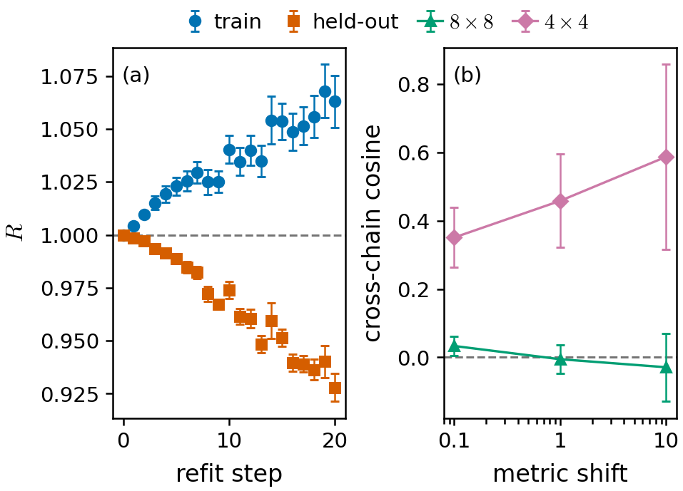

# One loop round at 8x8 cannot keep the correction step's gain (Test L8, closed 2026-10-26)

- **Finding.** Retraining the 8x8 RBM+PP network toward the walker solution of "network + one Lanczos hop" learns nothing that
  holds on independent samples: held-out fidelity ratio R falls from the first step (0.9984(7) at step 1, 0.928(7) at step 20)
  while the training chain's rises (1.063 at step 20); panel (a). Refit job Paderborn 3923271, /scratch/a/A.Otaifi/l8/prod/F.
- **Cause (derived, checked exactly at 4x4).** At the network's VMC energy optimum the fidelity gradient toward its own one-hop
  state equals alpha x (energy gradient) = 0. Exact 4x4, two restricted classes: identity holds to 5e-9 (f-only) and 2e-10
  (RBM-only); a two-hop target, run as the broken version, gives a gradient 31x / 5.5x larger. An exact refit toward the
  one-hop state gains R = 1.000009, so nothing at second order either. Script l8/l8_idtest4x4.py, logs /scratch/a/A.Otaifi/l8/idtest4x4/.
- **What a refit could store.** Only the walker method's gain beyond the hop. At 4x4 (RBM-only) an exact refit recovers 38% of
  it (-1.16e-4/site). At 8x8 that part is 2.3e-5/site in total (VMC p=1 -0.498923(17) vs FN p=1 -0.498946(5)), under a tenth
  of the remaining gap to DMRG (2.5e-4/site).
- **It is not resolvable from samples at 8x8.** Cross-chain cosine of the two chains' natural gradients at the start network
  (102400 walkers per chain): +0.033(29) with 16k VMC samples (job 3973532), -0.010(35) with 131k (job 3995351); the 4x4
  control gives +0.35(9) but started from an under-trained network (30 L-BFGS steps), so it tested the estimator, not this
  regime; panel (b).
- **Controls that passed.** Walker dump leaves the walk bitwise unchanged; overlap estimator equals exact 4x4 overlaps (worst
  |z| 1.56); wrong-sign weights lower the fidelity (0.915 vs 0.990); zero-step refit reproduces the guide constants exactly;
  walker weights healthy at 8x8 (n_eff/n 0.997, largest share 4.6e-5). Details l8/STATUS.md.
- **Not explained by this.** The 6x6 refit tax (1.02 x the round gain) had a two-hop target, where the gradient is not zero;
  that loss came from the near-node tail.
- **Cost.** ~3.1 H100-h of the 15 budgeted (dumps 2.9, refit 0.07, diagnostics 0.06, pilot 0.15).
- **Consequence (lead's view).** A loop that stores each round in the same network class has no first-order gain from the hop
  and at most ~1e-5/site per round from the rest, so it cannot beat training a bigger network. The working method is the
  network plus Lanczos hops plus fixed-node walkers, without the refit; whether that pays off as an add-on is the 10x10/12x12 test.
