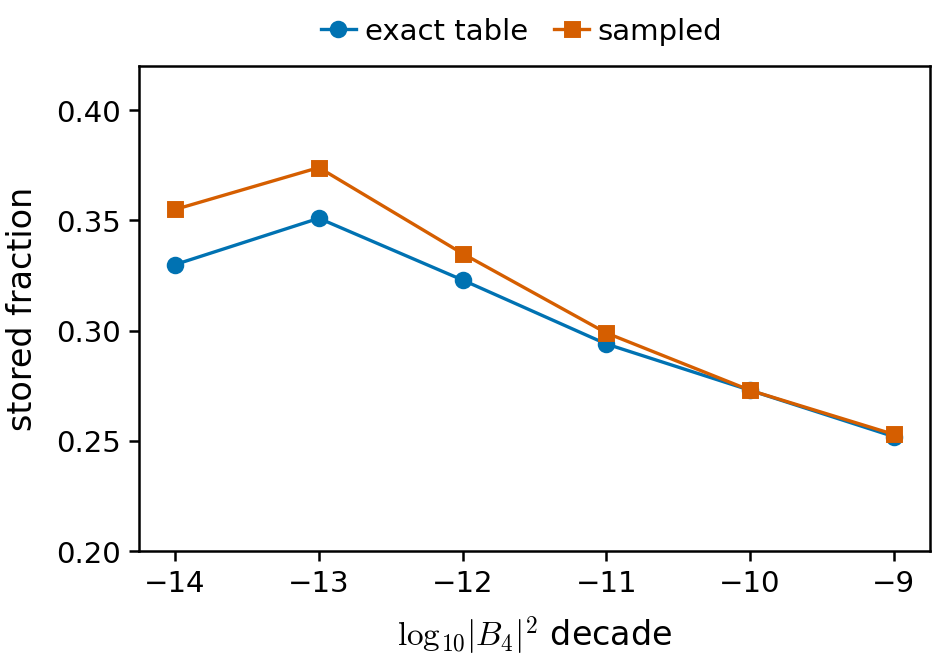

# Test V: does the storage step survive fitting from samples? (6x6, J2/J1 = 0.5, round 5, 2026-11-04)

- **Finding: yes, at 6x6 with an exact sign.** Fitted from 4e5 samples, the round-5 step keeps r_V = 0.4636 against 0.4929 from the exact table, a ratio of 0.941 (`/scratch/a/A.Otaifi/ansatz_runs/pfaffian_v/readout/readout.json`, `verdict_numbers`: r_V, exact_table_pp2_s1.r_5, r_V_over_r5). Pre-registered bars: PASS r_V >= 0.35, KILL r_V < 0.25 (same file, `pass_r`, `kill_r`). Verdict PASS.
- **Question.** Can the loop's storage step (fit a network to the next-round table) be done from sampled configurations instead of exact tables? Network: two-pair-product, sign s_G (exact), 6x6, round 5.
- **Setup.** 4e5 configurations drawn from |B_4|^(2 beta), beta = 1, 1/2, 1/4 (about 1/3 each); exact target value at each sample; same fitter as the exact-table fit, 1500 steps, seed 1. Graded by the exact fixed-node energy over the full table. Spec: `/scratch/a/A.Otaifi/ansatz_runs/pfaffian_v/readout/ANALYSIS_BRIEF.md`.
- **Bare energy.** Sampled fit e = 8.561e-6 per site; exact-table fit 8.332e-6; round-4 start 1.2184e-5 (`readout/readout.json`: e, exact_table_pp2_s1.e, pre_e; control e in `readout/aug/readout_aug.json`, `control_pp2_s1.e`).
- **Augmented guide (minimum of the c-scan, c* = 4.0 for both).** Sampled V: 3.346e-6 per site; exact-table control_pp2_s1: 3.258e-6 (`readout/aug/readout_aug.json`, `verdict_numbers.b1.e_aug_min` and `control.e_aug`). Difference 0.088e-6.
- **Against the competitor.** Competitor 5.574e-6 per site (`projects/j1j2/PLAN.md`, line 451). Augmented V is 2.23e-6 below it; this uses the exact sign s_G, not a stored one.
- **Generalisation check.** Stored fraction (kappa) per decade of |B_4|^2, on orbits never in the pool (98-99% of every deep decade): V 0.253 / 0.273 / 0.299 / 0.335 / 0.374 / 0.355 in decades -9..-14; exact-table fit 0.252 / 0.273 / 0.294 / 0.323 / 0.351 / 0.330 (`/scratch/a/A.Otaifi/astra/v_go_opus/gap.json`, keys `T_b1_V`, `T_b1_X`, field `notpool`; `gap.log`). V stores as much or more off-pool.
- **Pool orbits vs off-pool.** On orbits in the pool V stores more still: 0.454 vs 0.374 in decade -13, 0.356 vs 0.335 in -12 (`gap.json`, `T_b1_V`, `poolx` vs `notpool`); held-out orbits give 0.370 and 0.334 (`ho`). That is local memorisation, small, and the exact fit shows no such gap (0.357 vs 0.351 in -13).
- **Why the comparison is like for like.** The target T_5^b1 differs from the old T_5 by exactly zero in decades -5..-13; 2, 16 and 91 orbits change in -14, -15, -16, carrying n|B_4|^2 weight 5.5e-11 (`gap.log`, `dTchange` lines).
- **Review.** PASS stands, "survives sampling" is narrow, and 8x8 needs more first: `projects/j1j2/reviews/2026-11-04_v_go_review_opus.md`.
- **Caveats.**
  - One seed and one pool; the 0.941 ratio is not robust (its 0.029 gap is about one E_FN walk unit per the review); a new-pool replica is running.
  - Exact s_G sign, not a stored one.
  - Draws come from the exact table CDF, so this tests coverage only, not an MCMC sampler; labels also come from the exact target table.
  - 6x6 only; the review estimates that at 8x8 the same S = 4e5 reaches ESS/P ~ 1 in the deep decades (estimate, not measured).

- **Figure** (`figs/2026-11-04_v_stored_fraction.pdf`, `.png`): stored fraction on never-pooled orbits, per decade of |B_4|^2; blue circles exact-table fit (`T_b1_X`), vermilion squares sampled fit (`T_b1_V`), from `/scratch/a/A.Otaifi/astra/v_go_opus/gap.json`. Both are exact full-table quantities, so there are no error bars; decades -9..-14 only (-8 holds 114 orbits, -7 one).
