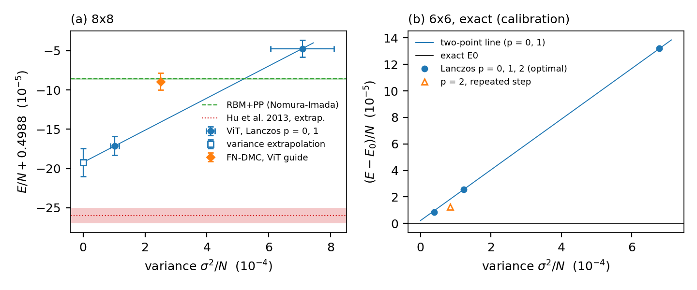

# Deliverable C, round 1 (2026-10-13/19): ViT + Lanczos + variance extrapolation + FN-DMC at 8x8

Pre-registration and amendments 1-4: `PREREG.md` (each amendment was written before the run it governs).
Literature: `LITERATURE.md`. Costed scale-up plan: `PLAN.md`. Code: `experiments/deliverable_C/`.
Paderborn drafts (not submitted): `cluster/paderborn/deliverable_C/`. ws1 run data: `/project/theorie/a/A.Otaifi/Chatty/runs/delC/runs/`.

Terms (per-site energies in units of J1, periodic 8x8, J2/J1 = 0.5):
- **psi_P**: our 8x8 ViT projected onto the D4 x spin-flip symmetry, with its own sign made real (binarised).
- **Lanczos step**: psi_1 = psi_P (1 + alpha (E_L - E_ref)), E_L = (H psi_P)/psi_P the local energy, fixed numbers
  alpha = -0.160951, E_ref = -31.92677568. One step = one more application of H ("one hop", ~145 configurations).
- **Direct VMC**: Metropolis sampling of |psi_1|^2 and the mean of its exact local energy: a variational upper bound.
- **Variance**: sigma^2 = <H^2> - <H>^2 of a state, per site; zero for an exact eigenstate.
- **Variance extrapolation**: straight line through (sigma^2_p, E_p) for p = 0, 1 Lanczos steps, read at sigma^2 = 0
  (Hu et al. 2013). An estimate of the ground-state energy E0, NOT a bound.
- **FN-DMC**: lattice fixed-node projector Monte Carlo with a guide state (ten Haaf et al. 1995). Its energy is a rigorous
  upper bound on E0 and lies below the guide's own energy. Protocol (calibrated at 6x6, results/fn_calibration_6x6):
  M = 512 walkers per population, beta-time average over the imaginary-time window [0.8, 2.4], mean over populations.
- **SE**: standard error from independent chains or populations.

## Results table (8x8)
| quantity | E/N | type | new? |
|---|---|---|---|
| psi_P (projected ViT), 98304 samples | -0.4988474(110) | bound | ours, not a record |
| **psi_1 = psi_P + one Lanczos step**, direct VMC, 11264 samples (review data + this round's late run) | **-0.498971(12)**; late-time only (>= 80 sweeps, 3072 samples) -0.498958(22) | bound | **yes**: 8.5e-5 below RBM+PP (late-only 7.2e-5, 3.3 SE) |
| **FN-DMC, guide psi_P**, 8 populations x 512 walkers | **-0.498889(11)** | bound | first FN energy with a deep-NQS guide for J1-J2; equals RBM+PP, above psi_1 |
> CORRECTION 2026-10-27 (index): PROVISIONAL: 8 populations; the calibrated referee protocol asks for >= 500 beta-time-averaged populations (AUDIT_2026-10-21 sec 1 row (1), sec 3 item 6). Quote -0.498889(11) only with this label.
| **variance extrapolation p = 0, 1** | **-0.498992(16)(8)** (stat)(sys); late-time psi_1 only -0.498974(27) | estimate of E0 | yes; 3.4 sigma above Hu's extrapolation |
| RBM+PP, Nomura-Imada 2021 | -0.498886(1) | bound | |
| Hu et al. 2013, VMC p = 2 | -0.49886(1) | bound | |
| Hu et al. 2013, variance extrapolation | -0.49906(1) | estimate | |
| DMRG torus, truncation-error extrapolation (Gong et al. 2014) | -0.4992(1) | estimate | |
| HQT transformer (arXiv:2607.00398) | -0.5001(1) | claimed bound, below every E0 estimate | not credible as a bound |

## What was done (steps, in plain words)
1. **Literature** (`LITERATURE.md`). Chen et al. 2022: RBM + Lanczos at 6x6 and 10x10 only. Wang-He-Lu 2026: CNN +
   Lanczos at 6x6 (p <= 2) and 10x10 (p = 1), no extrapolation. Roth et al. 2023: Lanczos only on the triangular lattice.
   Chen-Heyl 2024: Lanczos inside their 10x10 zero-variance extrapolation, no tabulated 8x8 energy. No NQS-guided FN/GFMC
   for J1-J2 found. The method is known; our 8x8 numbers are new.
2. **Variance extrapolation** (existing raw data plus 1024 new late-time psi_1 samples, amendment 4).
   - Inputs: psi_P VMC, 98304 samples / 2048 chains; psi_1 direct VMC, 11264 samples. Variances per site:
     sigma^2_0 = 7.08(1.02)e-4, sigma^2_1 = 1.03(0.14)e-4 (ratio 0.14).
   - Line through both points: **E0 = -0.498992**, chain-bootstrap SE 1.6e-5, pre-registered systematic +-8e-6.
   - Calibration on exact 6x6 data (`p2rep_6x6.json`, results/lanczos_baseline_6x6): the same two-point line from psi_P
     lands 2.2e-6 above the exact E0 (variance ratio 0.18 there), from the worse ViT(rep) start 7.7e-6 above. Panel (b).
   - Late-time check (amendment 4): late-only psi_1 samples give -0.498974(27); late minus all +1.8(2.4)e-5, below
     2 sigma, so "all" is primary by the pre-registered rule.
   - Heavy tails: 5 of 98304 psi_P samples carry 26% of sigma^2_0. Removing the 5 / 10 / 30 most extreme samples of each
     set moves the extrapolation by +0.3 / +0.6 / +1.3e-5 (E and sigma^2 move together; below the 2x rule).
     A second estimator of sigma^2_0 (<(H^2 psi)/psi> - <H>^2) moves it by ~1e-6.
   - To reach Hu's -0.49906, sigma^2_1 would have to be ~2.9x the measured value with sigma^2_0 fixed.
   - Pre-registered comparison: |-0.498992 - (-0.49906)| = 6.8e-5 = **3.4 combined sigma: in tension with Hu et al.**
     (late-only value: 2.9 sigma); 2.1 sigma from DMRG -0.4992(1). Our line starts 1.1e-4 below Hu's best p = 2 state
     and extrapolates over 2e-5 instead of Hu's 2e-4. Hu's extrapolation also lies below the best values at 6x6
     (-0.50382(1) vs exact -0.503810) and at 10x10 (-0.49781(2) vs Chen-Heyl ZVE -0.497715(9)).
3. **FN-DMC with the psi_P guide** (`dc_fn.py`: update rules of the calibrated 6x6 referee; the projected ViT is
   evaluated once per new walker configuration and cached).
   - Gate V1 on 4x4 against exact FN energies, two deliberately bad toy guides: after extrapolating the population-control
     bias in 1/M the code reproduces the exact value (a = +3.0(1.9)e-5 and +2.4(3.4)e-5). The bias is b/M with b set by the
     guide's variance; for psi_P (74x smaller variance) the prediction at M = 512 is ~2.5e-7. The first gate run failed by
     the letter; amendments 1-2 record the diagnosis (projection transient, then 1/M population bias) before the 8x8 run.
   - 8x8 run: 2 jobs x 4 populations, beta to 3.2 (amendment 1), 7.2 GPU-h on A40 slices (cap 9). Both jobs stopped at
     the time cap after one batch (contended slices: ~2.1e3 evaluations/s instead of 5.2e3), so 8 populations instead of
     the 16 planned. Population sd 3.0e-5 per site, SE 1.07e-5.
   - Result (protocol window): **E_FN = -0.498889(11)**. Below psi_P by -4.2(1.5)e-5 (resolved, 2.8 sigma; 30% of
     psi_P's distance to the extrapolated E0, vs 23% at 6x6). Equal to RBM+PP within errors; 8e-5 above psi_1, so not a
     new best bound (as predicted in PREREG).
   - Transient check: late window [2.4, 3.2] minus protocol +2.3(1.8)e-5 (no downward transient); [1.6, 3.2]:
     -0.498876(5). With 8 populations the SE itself is uncertain by ~25%.
4. **p = 2 (two Lanczos steps)**: pilot only (pre-registered). The local energy of psi_2 needs psi_P on the three-hop
   ball: 4.44e5 configurations, 86 s per sample on an A40 slice. From 64 samples the optimal 3x3 Ritz coefficients are not
   estimable (the tail decides them), so psi_2 = psi_P f^2, the repeated step (amendment 3). Exact 6x6: the repeated
   step keeps 78% of the optimal p = 2 gain (1.23e-5 vs optimal 8.6e-6, from 2.55e-5 at p = 1; a Lanczos step on psi_1
   keeps 86%), and the three-point extrapolation with it is within 1.5e-6 of E0. 8x8 paired SE 5e-6 needs ~1.9e4
   samples (~1.1e10 evaluations, ~130 H100-h at the measured H100 NVL speed): Paderborn draft `p2_prod_h100.sbatch`.
   Expected gain ~1-2e-5 per site, so p = 2 mainly adds a third extrapolation point.
5. **10x10 preparation**: the public checkpoint uses the same ViT code as ours; our 10x10 instance has 434,760
   parameters, exactly the card's number, and revision symm_trxy_ising is the same projection (sum of amplitudes over 32
   permutations x spin flip) as psi_P. Measured cost: 2.2e3 symmetric evaluations/s on an RTX 2080 Ti (8x8 psi_P:
   4.6e3/s on the same card). The weights were NOT downloaded (needs the user's explicit OK). Loader + VMC reproduction
   gate ready: `dc_vit10.py`.
6. **Throughput** (8x8 psi_P, 64 passes, fp32 full precision): A40 slice 5.2e3/s, full A40 5.2e3/s, RTX 2080 Ti
   4.6e3/s, H100 NVL (ws1 inter, 45 s probe) 2.36e4/s (`probes/`).

Figure: (a) 8x8 energy against variance: psi_P (p = 0) and psi_1 (p = 1) with bootstrap errors, the two-point line and
its sigma^2 = 0 value (error: stat + sys). Lines/bands: RBM+PP bound and Hu et al.'s extrapolation. Diamond: FN-DMC with
the psi_P guide (an energy only; its horizontal position is arbitrary). (b) exact 6x6 calibration: optimal Lanczos
p = 0, 1, 2, the repeated-step p = 2 state, the two-point line, and the exact E0.

## What is new and what is not
- Not new: the methods (NQS + Lanczos: Chen et al. 2022, Wang-He-Lu 2026; variance extrapolation: Hu et al. 2013;
  lattice FN-GFMC: ten Haaf et al. 1995).
- New: (i) the 8x8 NQS + one Lanczos step bound -0.498971(12), the lowest 8x8 variational energy in the survey
  (8.5e-5 below RBM+PP); (ii) an 8x8 E0 estimate -0.498992(18) that disagrees with Hu's -0.49906(1) at 3.4 sigma;
  (iii) the first FN-DMC energy with a deep-NQS guide for this model, -0.498889(11) (not a record: it equals RBM+PP).

## Open problems (each with its cause and the test that settles it)
- The extrapolation rests on two points. If the curvature at 8x8 differs from 6x6 the two-point value can be off by more
  than 8e-6. Test: the p = 2 point (three-point linear vs quadratic, pre-registered), Paderborn.
- Heavy tails: variances are carried by < 0.1% of the samples. The trim test shows the extrapolation is insensitive
  (E and sigma^2 move together), but an unseen tail in sigma^2_1 alone would lower the estimate. Test: the p = 2 run
  re-measures sigma^2_1 on fresh, mixture-sampled data.
- FN-DMC with the psi_1 guide (the candidate for the best 8x8 bound): at 6x6 it removed 26% of psi_1's error, which
  would give ~-0.498977 here, only ~6e-6 below psi_1, at ~146x the cost of the psi_P run (~11 H100-h per population).
  Low priority.
- 10x10: waiting for permission to download the public checkpoint; Lanczos there is Paderborn-scale (PLAN.md).

## Cost (ws1, this round): 10.2 GPU-h of 25
| item | GPU-h |
|---|---|
| p = 2 pilot (A40-16gb slice) | 1.53 |
| FN-DMC 8x8, 2 jobs (A40-16gb slices) | 7.24 |
| late-time psi_1 run (RTX 2080 Ti) | 1.27 |
| smoke tests, probes, exact 6x6 check | 0.15 |
| 4x4 gates | CPU (laptop) |

## 12x12 RBM+PP cost pilot (PREREG E5): result (2026-10-19)
- **Result:** ran 17:08-18:08 on one H100 (gpu1014), 20 SR steps before the 1 h limit (`pp12pilot_3749014_log.txt`).
  96.6 s per SR step with the published 576-image projection during training, 25 min to thermalise, ~92 GB device memory
  requested. E/N -0.088 -> -0.187 in 20 steps from a random start. Projected training cost by the pre-registered rule:
  **~266 H100-h (lower bound) -> fails the <= 100 H100-h line; option (b) as configured is not the cheap route.**
- Cost cuts to test before any 12x12 training (each is a short pilot): train without projection (576x fewer
  determinant evaluations per amplitude) and project only for the final energy; Nomura's 4x4-sublattice PP (fewer
  parameters); warm start from the 6x6 PP tiled to 12x12; fewer samples in the early steps.

### History of the pilot submission
- Submitted to Paderborn `gpu_h100` on 2026-10-19 14:3x as job **3749014** (`cluster/paderborn/deliverable_C/rbmpp_L12_pilot_h100.sbatch`,
  code staged in /pc2/users/h/hpcalot/chatty/j1j2/src/rbmpp/). Time limit reduced to 1 h after submission (lead: 1-hour pilot).
  Output will land in /pc2/users/h/hpcalot/chatty/j1j2/results/delC_pp12pilot_3749014/ (rbmpp_train.py json + params every
  25 steps) and delC-pp12pilot-3749014.out.
- Last seen (16:20): PENDING (Priority), the only pending job in gpu_h100, Slurm's start estimate 2026-10-20 02:30
  (moved earlier from 21:50 to 14:40 to 02:30 during the afternoon); all H100 nodes busy.
- Access: via ws1 -> PC2 VPN (pc2-vpn-start, saved setup) -> `ssh -o HostName=login1 -o HostKeyAlias=login2 paderborn`
  (login2 down). The VPN dropped at ~17:00, and ws1 has refused or hung SSH since then; polling stopped on the lead's
  instruction. To resume: restart the VPN on ws1, then `sacct -j 3749014` and read the output directory.
- Not started (scope decision 2026-10-19, drafts only): full 12x12 training, 10x10 reproduction and Lanczos
  (`vit10_lanczos_h100.sbatch`, `dc_lanczos10.py`, untested on real weights), 8x8 p = 2 production, FN-DMC psi_1 guide.
