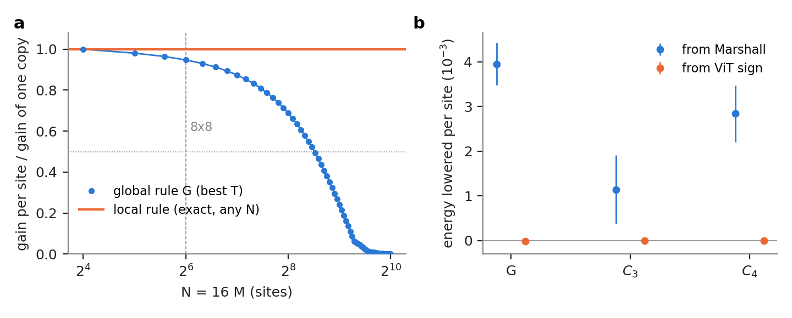
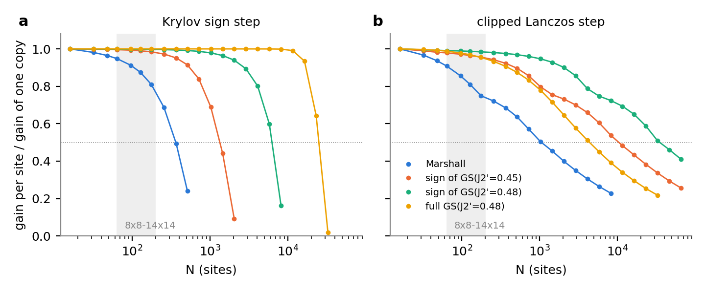

# Checks (a0) and (a8): global vs local Krylov sign step (2026-10-13)

Pre-registration: `PREREG.md` (commit 34fde1a, before any gain was computed). Design:
`projects/j1j2/DESIGN_scalable_loop_2026-10-13.md` (1.2-1.5, 3 (a0), (a8)). Code: `projects/j1j2/experiments/local_krylov/`.
CPU only (Mac), about 1.5 h of compute.

Terms used below:
- **Sign-only Krylov step:** keep the amplitude a, flip the sign of some configurations. Energy is measured on the same
  a^2 samples (no reweighting needed).
- **Global rule G:** flip x if its local energy E_L(x) = (H psi)(x)/psi(x) is above one threshold T.
- **Local rule C_w:** cut the lattice into all translates of a w x w window, compute each window's energy excess (sum of
  its bond energies minus their mean), mark windows above theta, flip x if the marked windows form an odd number of
  connected clusters.
- **Gain:** change of <H> per site; negative = better. **Cross-fitted:** threshold chosen on one half of the chains,
  energy measured on the other half (16 random halvings), so the gain is not inflated by choosing on the same data.
- **SE:** larger of the per-chain SE and a chain bootstrap of the whole procedure (incl. threshold choice).

## (a0) Decoupled 4x4 copies (exact; calibration)
Steps: exact ground state of the periodic 4x4 J1-J2 model (J2 = 0.5), E0 = -8.4579233514 (repo value to 2e-14). Guide
per copy: |psi0| with the Marshall sign (energy error 1.16e-2 per site). For M = 1..64 copies (N = 16..1024) the exact
gain of one global step at its best T, from the per-copy structure (an edge changes sign only if the other copies' summed
local energy falls in a known interval; FFT for the distribution of that sum).
Checks (all pass): brute force M = 1 (5e-15) and M = 2 on the explicit 12870^2 state (2.3e-11); local rule on the
explicit M = 2 state = one-copy gain (1.5e-11); grid vs exact at M = 2 (1e-15) and M = 3 (2e-6 relative); Monte Carlo at
M = 16 and 64 within 1.8 and 1.2 SE.

| N | 16 | 32 | 64 | 128 | 256 | 384 | 512 | 768 | 1024 |
|---|---|---|---|---|---|---|---|---|---|
| G gain / one-copy gain | 1 | 0.98 | 0.95 | 0.87 | 0.69 | 0.47 | 0.24 | 0.011 | 0.0006 |

- One-copy gain: -1.101e-2 per site (95% of the Marshall error); the local rule keeps this at every N (exact).
- **M_1/2 = 23, N_1/2 = 368 > 64.** Pre-registered reading: at 8x8 the global rule is not yet diluted; a null of
  G vs C in (a8) is expected.
- Mechanism visible in the curve: slow sqrt(N) dilution up to N ~ 256, then a collapse once configurations typically hold
  several defects (1.3% flip weight per copy), where one threshold on the total cannot count their parity.
- Translation to the 8x8 guide (rough, secondary): the 8x8 Marshall-on-ViT-amplitude guide has ~2.4x lower E_L
  variance per site and ~2.5x lower flipped weight per site than the 4x4 copies, so its N_1/2 is likely larger still.

## (a8) 8x8, existing two-hop data (7680 samples of |psi_P|^2, 3072 chains; signs_8x8 RA/RB1/RB2)
Steps: for every sample x and all its ~145 neighbours, bond energies from the stored two-hop guide values (sum check
3.6e-12); for each rule and each of 240 thresholds the exact local energy of (a, s') at x; cross-fitting and bootstrap
as above; leave-one-batch-out as a second cross-fit (agrees in every case).

| start | E/site of start | G | C_3 | C_4 | C_sel (w chosen in-fold) | C_sel - G (paired) |
|---|---|---|---|---|---|---|
| Marshall | -0.493865(218) | **-3.96(0.24)e-3** | -1.14(0.38)e-3 | -2.84(0.32)e-3 | -2.84(0.32)e-3 (w = 4 in 32/32 folds) | **+1.11(0.30)e-3** |
| ViT sign | -0.498769(49) | +0.99(3.2)e-5 | +0.35(0.57)e-5 | +0.14(0.88)e-5 | +0.35(0.75)e-5 | -0.64(3.3)e-5 |

C_2 (secondary): Marshall +0.03(0.11)e-3, ViT +0.2(1.3)e-5.

**Pre-registered verdict:**
- Marshall start: **not passed.** C_sel lowers the energy (own gain 8.9 SE) but the global rule lowers it more; the
  paired difference favours G by 3.7 SE (C_3: by 7.3 SE).
- ViT start: **not passed.** No rule gives a resolvable gain (in-sample best: G -2.4e-5, C -1e-6 per site).
- Since N_1/2 = 368 > 64, the ViT null is "expected at this N". The Marshall result is not a null: at 8x8 the local
  rule is measurably worse than the global one. Status: **inconclusive for the scaling question (cause: 8x8 is below
  the dilution scale of the global rule; the local rule's own noise floor, below, is the measured cost)**.

**Diagnostics.**
- Locality premise holds for Marshall defects: in the top 1% of E_L, median 96% of the excess sits in one 4x4 window
  (uniform spread would give 16%). For the ViT sign there are no visible defects: the top-1% excess is only +0.5
  (2 sigma of E_L), smaller than ordinary window fluctuations.
- Merging is not the problem: at the chosen thresholds samples have 0 or 1 cluster (C_4: 7539 / 141; C_3: one sample
  with 2). Flipped fractions are similar (Marshall: G 2.0% of samples, 9.4% of neighbours; C_4 1.8%, 11.0%).
- **Window noise floor (the cause of C < G at 8x8, `a8_noise.json`).**
  - sd of the total E_L: 1.19 (Marshall), 0.27 (ViT).
  - sd of one 4x4 window's energy: 1.15 and 1.08, for both starts; its diagonal (0.77) and off-diagonal (1.0) parts
    are both large.
  - Defect-free samples already reach a maximum window excess of 2.4 (median) to 4.5 (99%) over the 64 windows.
  - So the local rule must set theta = +5.5 (C_4), while G sits at T - E = +4.7 against a background sd of 1.19.
  - In a good state the bond-energy fluctuations of different regions cancel in the total (ViT: 0.27 total vs 1.08
    per window). A window statistic loses this cancellation. This is failure mode (i) of the design (the exact
    ground state is not an eigenstate of H_W), now measured.
- Scaling estimate (not measured): the global noise grows as sqrt(N), the local floor as about sigma_W sqrt(2 ln N).
  For the Marshall start they cross near N ~ 10^3, consistent with N_1/2 = 368 from (a0).

## What it means for the 8x8 loop
- 8x8 is not in the regime where the global rule fails (gain ratio 0.95 at N = 64 in (a0)). At 8x8 the global rule
  beats the local rule as designed.
- From the ViT sign neither rule finds anything: the ViT sign has no defect the one-hop data can resolve.
- For the 8x8 loop (c), use G for the sign step, or C_4 only alongside it. The local rule is needed from about
  16x16-20x20 up, and before that it needs a lower-noise window statistic. Candidates for the design partner:
  - subtract a learned or conditional baseline of each window's energy (a control variate fitted on a^2 samples);
  - threshold on a variance-normalised excess;
  - combine G and C (flip if either fires, with joint thresholds).
  Test any of them first on the 6x6 exact lab (check (a), S0 false-flip bar), where the window noise of the exact
  ground state is known.

Files:
- `a0_copies.json`: curve and all checks.
- `a8_analysis.json`: all gains, SEs, thresholds, diagnostics.
- `a8_noise.json`: noise scales.
- `a8_run_meta.json`: grid inputs, e_bar.
- `fig_local_krylov.{png,pdf}`.
- Per-sample Delta matrices (28 MB): ws1 `/project/theorie/a/A.Otaifi/chatty_local_krylov/a8_delta.npz`.

(a) Exact global-rule gain per site on M decoupled 4x4 copies, relative to one copy; the local rule stays at 1.
(b) 8x8 cross-fitted energy lowered per site, error bars 2 SE.

Reproduce: `python a0_copies.py a0_copies.json 2e-3`; `python a8_run.py OUT RA RB1 RB2` (signs_8x8 run dirs);
`python a8_analyze.py OUT/a8_delta.npz OUT/a8_run_meta.json a8_analysis.json`; `python a8_noise.py a8_noise.json RA RB1 RB2`;
`python lk_figure.py a0_copies.json a8_analysis.json fig_local_krylov`.

## Follow-up F1: when does a global step dilute, for the amplitude engine and for good guides? (2026-10-13)
Pre-registered in `PREREG.md`, section F1 (commit 658a9b1). Amendments A1-A3 were all grid fixes after failed
checks; each is recorded before the rerun.
Steps: same decoupled-4x4-copies machinery as (a0), one global step from the guide on M copies, exact per-copy
structure.
- **K** is the Krylov sign step.
- **L** is one Lanczos step psi (1 + alpha (E_L - E)) with the best alpha, in closed form from the per-copy energy
  moments.
- **Lc** is the clipped Lanczos step psi sgn(f) max(|f|, 0.3) with the best alpha.

Guides per copy, from sign-poor to NQS-like:

| guide | built from | energy error / site | wrong-sign weight w_s (per copy) |
|---|---|---|---|
| MAR | Marshall sign on \|psi0\| | 1.2e-2 | 1.3e-2 |
| P45s | sign of the exact GS at J2' = 0.45, on \|psi0\| | 1.2e-3 | 9e-4 |
| P48s | sign of the exact GS at J2' = 0.48, on \|psi0\| (ViT-level error) | 3.9e-4 | 2.3e-4 |
| P48f | full exact GS at J2' = 0.48 (amplitude and sign errors) | 3.3e-4 | 2.6e-4 |
| F3 / F4 | random isolated flips of the exact sign | 1.6e-3 / 1.9e-4 | 1e-3 / 1e-4 |

Checks:
- L vs brute force (explicit M = 1, 2 states): within 9e-12 per site.
- Lc vs brute force: M = 2 within 7e-5 relative.
- M = 1 Lc: 1e-6 relative. This misses the 1e-10 bar, because of the A2 bin aggregation; it is negligible for ratios.
- Lc with the clip -> 0 equals L: within 3e-10.
- h-halving at N_1/2: all within 0.003.

N_1/2 is the size at which the gain per site has halved relative to one 4x4 copy. r(N) is that gain ratio at N.

| guide | K: N_1/2 | L: N_1/2 | Lc: N_1/2 | r(192) K / L / Lc |
|---|---|---|---|---|
| MAR | 364 | 1310 | 1053 | 0.78 / 0.82 / 0.74 |
| P45s | 1339 | 17964 | 10407 | 0.98 / 0.98 / 0.95 |
| P48s | 6263 | > 65536 | 34886 | 1.00 / 1.00 / 0.98 |
| P48f | 25076 | 10280 | 4374 | 1.00 / 0.97 / 0.95 |
| F3 | 5854 | 11499 | 10351 | 0.98 / 0.97 / 0.97 |
| F4 | 57531 | > 65536 | > 65536 | 1.00 / 1.00 / 1.00 |

**Pre-registered readings:**
- **Amplitude engine:** for P48s and P48f, r(192) for L and Lc is 0.95-1.00, at or above 0.8. So global Lanczos is
  adequate through 14x14; it is not diluted there.
- **Sign step:** for the low-defect guides r(192) for K is 0.98-1.00, also adequate.
- Dilution sets in at the 8x8-14x14 scale only for a Marshall-like guide (K r(192) = 0.78, Lc 0.74).

**Rules of thumb:**
- **Krylov sign step (pre-registered fit):** N_1/2 ≈ 0.24 / (wrong-sign weight per site), slope 0.99, within a
  factor 2.9 over the six guides. Fitting energy error instead gives the same spread: N_1/2 ≈ 1.9 / eps^1.14.
- **Lanczos step (post hoc, analytic, beats both pre-registered fits):** N_1/2(L) ≈ 2 kappa3^2 / kappa2^3, with
  kappa_k the per-site energy cumulants of the guide. Equivalently: the step is half-diluted once the skewness of the
  guide's energy over the whole system falls to 1/sqrt(2).
  - Predicted vs measured: 1212 / 1310, 17842 / 17964, 10169 / 10280, 11402 / 11499; P48s and F4 are predicted
    beyond the grid, as measured.
  - The rule follows from E(alpha) depending only on m2 = N kappa2 and m3 = N kappa3. It therefore holds for any
    short-range-correlated state, not only for products.
  - Lc halves at 0.4-1x the L value.
- **8x8 application (secondary, `a8_skew.json`, two-hop data, 7680 samples):**
  - ViT guide: N_1/2(L) ≈ 6e4 sites (3e5 with the top 0.1% of |E_L - E| removed). The third moment is heavy-tailed:
    m2 SE 43%, m3 SE 41%, so this is an order of magnitude only.
  - Marshall on the ViT amplitude: ~3000 sites.

**Meaning for the loop:**
- Between 8x8 and 14x14, neither the global Krylov sign step nor one global (clipped) Lanczos step is size-diluted
  for guides of ViT quality.
- The size-consistency problem of the 2026-10-13 decision becomes binding only at N ~ 10^3-10^4 for good guides, or
  at ~400 for sign-poor ones.
- So within 14x14, the advantage of a size-consistent engine has to come from somewhere other than dilution of one
  global step: for example, from repeated steps, or from the cost of each hop.

Files:
- `a0f_dilution.json`: curves.
- `a0f_checks.json`: brute-force checks.
- `a0f_summary.json`: table, fits and the skewness rule.
- `a8_skew.json`: 8x8 energy cumulants.
- `fig_dilution_guides.{png,pdf}`: (a) K and (b) Lc, gain ratio vs N for four guides; grey band = 8x8-14x14.
  L is close to Lc and is in the json.

Code:
- `experiments/local_krylov/a0f_dilution.py` (K, L, Lc).
- `a0f_checks.py` (brute force).
- `a0f_summary.py` (fits).
- `a8_skew.py` (8x8 cumulants).
- `a0f_figure.py` (figure).

