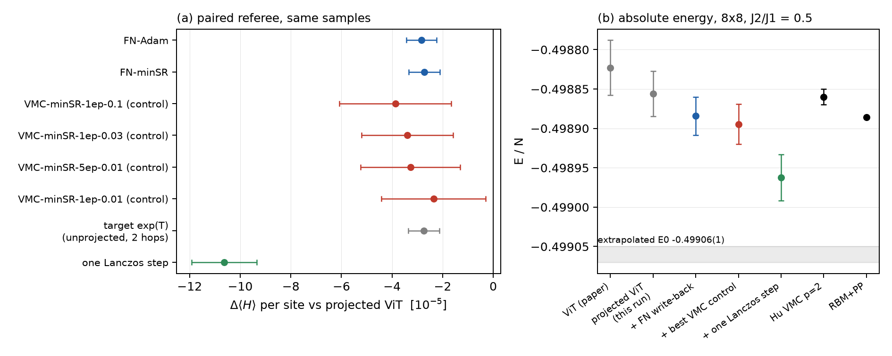

# 8x8 route B: one FN write-back iteration from the projected 8x8 ViT, with a same-sample VMC control

Periodic 8x8 J1-J2, J2/J1 = 0.5.
- Pre-registration: `experiments/loop_8x8/README.md`, commit c07933d; amendments 1-3 in dffc1b5 and 2217841, all made
  before any referee evaluation of a write-back.
- Code: `experiments/loop_8x8/`.
- Run data: ws1 `/project/theorie/a/A.Otaifi/Chatty/runs/loop8/runs/` (pool 28 MB; referee 4 x ~70 MB; parameters).

## Verdict: INCONCLUSIVE (cause: the control is not resolved), and one Lanczos step gains 3.7x more
- **Criterion (i) PASSES.**
  - The FN write-back (FN-Adam, pre-registered checkpoint) lowers <H_ph> of the projected ViT guide by
    **-2.84(0.59)e-5 per site, z = 4.8**.
  - FN-minSR agrees: -2.72(0.61)e-5.
  - The write-back keeps 103(30)% of the gain contained in its own target: the unprojected semi-implicit step
    exp(T) gives -2.75(0.61)e-5.
- **Criterion (ii) FAILS on point estimates.**
  - The five pre-registered 20k-step VMC controls all collapse on the fixed pool (weights exp(2f) concentrate). At
    their selected checkpoints they gain nothing (step 0) or are far worse.
  - But the single-pass minSR VMC controls added in amendment 3 reach -2.4 ... -3.9e-5 at their pre-registered
    checkpoints, each with SE ~2e-5.
  - The best of them, VMC-minSR-1ep-0.1 at -3.87(2.21)e-5, is above |Delta_FN| / 1.5 = 1.9e-5.
  - Paired FN minus control: **+1.0(1.9)e-5**. With the other single-pass controls: -0.5(1.7) and +0.6(1.6); with the
    five-pass control: +0.4(1.6)e-5.
  - So the FN arm does not beat the best control by the required 1.5x. The comparison is unresolved: the control's
    change of f is three times rougher (rms edge difference 0.09-0.14 vs 0.019), which makes its referee SE three
    times larger.
  - Choosing the best of seven noisy control arms favours the control (winner's curse). That was accepted in the
    pre-registration as conservative for us.
  - Adam VMC on the same samples gains nothing: |Delta| <= 2e-6.
- **External baseline:** one Lanczos step on the same guide, from the same two-hop referee data, gives
  **-1.06(0.13)e-4**, 3.7x the write-back gain.
  - A Lanczos-step state psi + alpha (H - E) psi costs one hop of the guide per amplitude evaluation, the same as the
    written-back guide (whose features need one hop).
  - At equal evaluation cost, the write-back from a converged ViT is therefore not competitive with a Lanczos step
    at 8x8, as already found exactly at 6x6 (RESEARCH_MAP 3d, 3k).
- **Why not FAILED:** no conceptual limit is shown.
  - The FN target is learned to ~100% and generalises: held-out edge loss 6.46e-6 -> 3.53e-7, no train/held-out gap.
  - The open point is statistical: the control's SE is ~2e-5. Resolving 1.5x at these gains needs a control SE of
    ~5e-6, i.e. ~16x the referee samples (~110 GPU-h on slices).
  - It is also structural: on a converged ViT the FN step and fixed-sign VMC agree to first order
    (review 2026-10-07, majorisation), so a large separation is not expected here.

## Table (referee: R = 12288 samples from |psi_P|^2, 3072 independent chains, exact local energies over all ~145 neighbours)
Delta is relative to the guide, per site, with the SE from per-chain means of the paired influence.
Absolute SEs (~2.5-2.9e-5) are dominated by the guide's own sampling noise; differences are paired.

| state | step (rule) | Delta <H_ph> per site | E/N |
|---|---|---|---|
| our ViT (paper, complex, translation-invariant) | | | -0.498823(35) |
| **guide: D4 x flip projected ViT, binarised own sign** | | 0 | **-0.498856(29)** (complex phase: -0.498856(29)) |
| **+ FN write-back, FN-Adam** (primary) | 20000 (best held-out) | **-2.84(0.59)e-5** | **-0.498884(24)** |
| + FN write-back, FN-Adam | 10000 | -2.92(0.61)e-5 | -0.498885(24) |
| + FN write-back, FN-minSR | 19000 (best) / 20000 | -2.72(0.61)e-5 | -0.498883(24) |
| unprojected target exp(T) (needs 2 hops, diagnostic) | | -2.75(0.61)e-5 | -0.498883(24) |
| control VMC-minSR-1ep-0.1 (best control) | 102 (best) | -3.87(2.21)e-5 | -0.498895(26) |
| control VMC-minSR-1ep-0.03 | 60 (best) | -3.39(1.81)e-5 | -0.498890(27) |
| control VMC-minSR-5ep-0.01 | 75 (best) | -3.27(1.97)e-5 | -0.498889(25) |
| control VMC-minSR-1ep-0.01 | 70 (best) | -2.36(2.07)e-5 | -0.498879(26) |
| controls VMC-Adam-1ep-1e-3 / 1ep-3e-4 / 5ep-1e-4 | 40 / 40 / 50 | +0.05(0.29) / -0.17(0.23) / -0.02(0.03)e-5 | -0.498856 |
| pre-registered controls VMC-Adam 3e-4 / 1e-4 / 3e-5, VMC-minSR 0.01 / 0.003 (20k steps) | 20000 / 9000 / 0 / 0 / 0 | +6.6e-3 / +3.1e-2 / 0 / 0 / 0 (collapsed; referee ESS 0.000 / 0.014 at the non-zero steps) | |
| **one Lanczos step on the guide** (2x2 Ritz, jackknife) | | **-1.06(0.13)e-4** | **-0.498962(29)** |
| RBM+PP (Nomura-Imada) | | | -0.498886(1) |
| Hu VMC p=2 | | | -0.49886(1) |
| extrapolations (Hu / DMRG torus) | | | -0.49906(1) / -0.4992(1) |

- Absolute: the written-back guide, -0.498884(24), sits at RBM+PP (-0.498886) within errors; it is not below it.
- The Lanczos-step energy, -0.498962(29), lies 7.6e-5 below RBM+PP (2.6 sigma on the absolute scale). It is a
  sampled-moment estimate, not yet confirmed by a direct VMC of the Lanczos state. It is a lead, not a claim.
- The interim referee (6144 samples) gave the same picture: FN-Adam -2.49(0.63)e-5, best control -3.13(2.7)e-5,
  Lanczos -7.4(1.0)e-5 (`eval_interim_6144.json`).

Figure (a): paired change of <H_ph> against the projected ViT. Blue: FN write-back arms. Red: the four best valid
controls. Grey: the unprojected target. Green: one Lanczos step. The collapsed 20k-step controls are off-scale and not
shown.
Figure (b): absolute E/N against the references. The grey band is the extrapolated E0.

## Method checks (rule 2)
- **Guide.**
  - The projection costs 16.4x per evaluation (5.2e3 vs 8.5e4 evaluations/s on an A40 slice), within the
    pre-registered rule.
  - The translation-invariant pilot gave -0.498853(32), consistent with the paper's -0.498823(35). The projected
    guide is about 1-2e-5 lower; this is not resolved by the separate samples.
  - The sign leak is 1e-4, so the binarised sign equals the complex energy.
  - No Krylov sign step was used: both arms and the baseline keep the ViT's own sign.
- **Target/features.**
  - 145 valid neighbours per configuration.
  - V/(V + W) = 16.6%: one sixth of the off-diagonal weight violates the ViT sign.
  - E_a comes from an independent pilot.
- **Optimiser and convergence (FN arms).**
  - FN-Adam: held-out own loss 6.46e-6 -> 1.15e-6 (1k) -> 4.13e-7 (10k) -> 3.53e-7 (20k); training loss 3.1e-7.
    Converging slowly, no overfitting; the referee gives the same Delta at 10k and 20k.
  - FN-minSR fits further: held-out 5.8e-9. It gives the same energy, so the remaining edge loss is not where the
    energy is. Unlike 6x6, minSR does not destroy the bulk here.
- **Feature clamp (amendment 2).**
  - Without it, one held-out configuration above the training log a range got f = -4.9 and held 99.96% of the held-out
    loss.
  - With the clamp, held-out = training.
- **VMC control.**
  - Same pool, weights and K = 8 neighbours. The local energy is exact except for the correction term.
  - On a fixed pool the reweighted-energy optimisation is unstable: the training estimate falls to -0.6 ... -11 per
    site within 2000 steps.
  - The held-out selection then picks step 0 or a collapsed state. A few single passes avoid the collapse and give
    real but noisy gains.
  - A control with fresh samples per step (standard VMC, as at 6x6) would use ~150x more samples.
- **Referee.**
  - Exact two-hop local energies, so there is no bond subsampling (check: E_L recomputed from the edges agrees to
    5e-14).
  - The referee ESS is 0.999-1.000 for all non-collapsed arms.
  - The E_L lag-1 autocorrelation at 1 sweep is ~0, and the SE comes from 3072 independent chains.
- **Lanczos estimator.**
  - Lowest Ritz value in span{psi, (H - <H>) psi} from centred sampled moments m2 = <(H - h1)^2> and
    m3 = <(H - h1)^3>, with (H^2 psi)/psi exact from the two-hop data.
  - A first alpha-parametrised version was numerically singular (denominator vanishing at alpha = -1/E) and was
    replaced before any arm evaluation.
- **FN-DMC referee: not run.**
  - The calibrated protocol (M = 512, beta 0.8-2.4, tau_max 0.025, >= 500 populations) needs the written-back guide
    on two hops per walker move: ~1e4 projected evaluations at 1.9 s on a slice.
  - That is ~2e4 GPU-s per population, i.e. ~6 GPU-h per population, x500.
  - Even the bare projected ViT guide (145 evaluations per move) needs ~0.3 GPU-h per population, i.e. ~150 GPU-h for
    500 populations. This is far beyond the 20 GPU-h budget.

## Cost (A40 vGPU slices, ws1; 12.2 GPU-h of the 20 GPU-h budget)
| stage | GPU-h | ViT evaluations per sample (projected = 16 network passes x 4 patch offsets) |
|---|---|---|
| probe (throughput, pilots) | 0.18 | |
| pool: 2 x 2048 chains x 8 samples (sampling 0.54 h, one-hop data on x and 8 neighbours 2.82 h) | 3.36 | 1246 projected evaluations per pool sample (0.31 s) |
| training: FN-Adam 0.13, FN-minSR 0.35, 5 x 20k-step VMC 0.47, 7 short VMC 0.05; a first pass without the clamp 0.30 | 1.3 | 0 (pool reused) |
| referee data: 4 x 3072 samples | 6.89 | 1.01e4 projected evaluations per sample (2.0 s) |
| referee evaluation (interim and final, all arms) | 0.49 | 0 |
| **total** | **12.2** | |

- The FN write-back's training data cost 0.31 s per sample. Its ideal one-hop form needs one hop of the projected base
  per amplitude (145 evaluations, 0.028 s).
- The paired referee resolving 6e-6 per site costs 2 s per sample, 7 GPU-h.

## Next step
1. Do not invest further in amplitude write-back from a converged ViT at 8x8.
   - The write-back gain (-2.8e-5) is one quarter of a free Lanczos step (-1.06e-4) at equal per-amplitude cost.
   - It is not separable from the best same-sample VMC control without ~16x more referee samples.
   - This is the reviewer's 3c threshold logic at 8x8: the 8x8 numbers reproduce the 6x6 verdict (3d, 3k).
2. The 8x8 lead to check is the Lanczos step itself: -0.498962(29), below RBM+PP -0.498886.
   - Confirm by direct VMC of psi_L = psi_P + alpha (H - E) psi_P with more samples (each amplitude = one hop of the
     projected ViT, ~0.03 s; 3e4 samples ~ 3-5 GPU-h).
   - Then test 'loop guide + Lanczos' vs 'ViT + Lanczos' (the fair test of review E). This is the only place where the
     write-back could still add value.

## Follow-up FU1-FU3 (pre-registered in d4f5936; 2026-10-11/12; ws1 A40 slices, Paderborn still drained)
Definitions:
- psi_P is the D4 x spin-flip projected ViT with its own binarised sign.
- psi_1 = psi_P (1 + alpha (E_L - E_ref)) is one Lanczos step. E_L(x) = (H psi_P)(x)/psi_P(x) is the local energy;
  alpha = -0.160951 and E_ref = -31.92677568 are fixed numbers.
- "Referee" is the paired estimator on 15360 independent samples of psi_P^2 (5 batches; 3840 chains), with exact
  local energies from the two-hop data.

**FU1: the Lanczos lead holds; it is below RBM+PP.** Steps:
- (a) Ran plain VMC of psi_P with 98304 samples (2048 chains): <H>_P = -0.4988474(106).
- (b) Computed one Lanczos step from the referee moments: Delta = -1.056(0.125)e-4.
  - The alpha scan by reweighting has its minimum at c = 1.0-1.25 x alpha*, with Delta = -1.21(0.28)e-4 at alpha*.
- (c) Sampled psi_1 directly (Metropolis on |psi_1|^2, each amplitude = one hop of psi_P; 512 chains, 2048 samples)
  and computed its exact local energies: E1 = -0.4989476(231).
  - Mirror paired Delta: -4.8(4.8)e-5.
  - The second direct job (b) and referee batch 9000 hit their time limits on a slow shared slice. Their output was
    lost; they were not rerun (budget).
- Pre-registered checks:
  - direct vs combined estimate: -0.4989476(231) vs -0.4989530(164), difference 0.2 sigma;
  - mirror vs forward Delta: 1.2 sigma.
  - Both agree within 2 sigma, so the result is **confirmed**.
- **Result: one Lanczos step on the projected ViT gives E/N = -0.4989530(164)**, that is <H>_P (a) + Delta (b).
  - This is 6.7e-5 (4.1 sigma) below RBM+PP -0.498886(1), and also below Hu VMC p=2 -0.49886(1).
  - The independent direct VMC alone, -0.4989476(231), is 2.7 sigma below RBM+PP.
  - By the pre-registered rule (E1 + 2 sigma < -0.498886) this is a new lowest variational 8x8 energy among the
    published values in our survey. It still needs an independent review (rule 7) before any claim.
  - The method (NQS + Lanczos step) is known (Chen et al. 2022); the number at 8x8 is new.

**FU2: the written-back guide adds nothing measurable on top of a Lanczos step.** Steps:
- An exact Lanczos step on the written-back guide b = psi_P exp(f) needs psi_P on three hops (~4e5 evaluations,
  ~80 s per sample), which is out of budget.
- Instead, on the same referee samples: the lowest Ritz value in span{psi_P, (H - E)psi_P, (b - psi_P)} against the
  Lanczos span{psi_P, (H - E)psi_P}. Paired, jackknife over 32 chain blocks.
- Extra gain from adding the write-back direction:
  - FN-Adam -0.7(3.4)e-6 / -0.5(3.2)e-6 / -0.8(3.4)e-6 per seed;
  - FN-minSR -2.9(2.6)e-5;
  - exp(T) -2.7(2.5)e-5;
  - VMC controls between 0 and -0.7(1.1)e-5.
- All are < 2 sigma: **the FN write-back adds no resolvable gain beyond one Lanczos step.**
- Cause: the FN direction is 97% collinear with the Lanczos direction (corr(f, E_L) = -0.97). The semi-implicit target
  T = log(1 + W) - log(1 + W + E_L - E) ~ -(E_L - E)/(1 + W) is a Lanczos step with a configuration-dependent step
  size 1/(1 + W). The uniform optimal step gains about 3.6x more.
- Caveat on the estimator: this symmetrised 2-state estimate gives -0.4989648 against -0.4989487 from the
  centred-moment Ritz value on the same samples. That 1.6e-5 spread, about 1 sigma, is the estimator systematic.

**FU3: the control is still not resolved.** Steps:
- Retrained FN-Adam and the four minSR VMC controls with 2 more seeds (3 seeds each).
- Scored each on the 15360-sample referee at its pre-registered checkpoint, then averaged the paired influences over
  seeds.
- Seed means (seed-to-seed sd):

  | arm | seed-mean Delta | seed sd |
  |---|---|---|
  | FN-Adam | **-2.92(0.51)e-5** | 0.03e-5 |
  | FN-minSR (1 seed) | -2.85(0.53)e-5 | |
  | VMC-minSR-5ep-0.01 | -3.81(1.78)e-5 | 1.15e-5 |
  | VMC-minSR-1ep-0.03 | -3.12(1.59)e-5 | 0.81e-5 |
  | VMC-minSR-1ep-0.01 | -1.98(1.56)e-5 | 0.44e-5 |
  | VMC-minSR-1ep-0.1 | -1.95(1.64)e-5 | 1.13e-5 |
  | VMC-Adam (all) | >= -0.3e-5 | |

- Paired FN-Adam minus control family:
  - +0.89(1.50)e-5 vs 5ep-0.01;
  - +0.20(1.37) vs 1ep-0.03;
  - -0.94(1.31) vs 1ep-0.01;
  - -0.97(1.42)e-5 vs 1ep-0.1.
- **Result:**
  - Criterion (ii) still fails on point estimates: the best control family gives -3.8e-5 > |FN| / 1.5.
  - The FN-minus-control SE is 1.3-1.5e-5, short of the 1e-5 target, because referee batch 9000 was lost.
  - What is resolved: FN and the best minSR VMC controls give the same gain within 1.5e-5. The FN write-back is 40x more
    reproducible across seeds (sd 3e-7 vs 1.1e-5) and does not need a well-chosen stopping point. The VMC controls
    collapse beyond about 1-5 passes over the pool.

**Absolute E/N summary** (each = <H>_P from (a) + a paired Delta):

| state | E/N |
|---|---|
| projected ViT | -0.4988474(106) |
| + FN write-back (3 seeds) | -0.4988766(117) |
| + one Lanczos step | **-0.4989530(164)** |
| direct VMC of the Lanczos state | -0.4989476(231) |
| RBM+PP | -0.498886(1) |

**FU cost: 13.2 GPU-h** (A40 slices):

| item | GPU-h |
|---|---|
| seeds | 0.17 |
| VMC of psi_P | 1.25 |
| direct psi_1 job a | 2.26 |
| direct psi_1 job b (timed out, lost) | 4.0 |
| referee batch 9000 (timed out, lost) | 3.5 |
| referee batch 10000 | 1.72 |
| evaluation | 0.28 |

- Of the 13.2 GPU-h, 7.5 were lost to slice contention (2.1e3 instead of 5.2e3 evaluations/s).
- Project total 25.4 GPU-h.

**Next.**
- An independent review of the Lanczos number. Check direct VMC with more chains, the sampling of the
  near-node region (min factor 0.07 in the reweighted set vs 0.86 in direct samples), and the literature.
- Then decide whether 'NQS + Lanczos (+ calibrated FN)' at 8x8/10x10 is the paper's scale result.
- The write-back from a converged ViT is equivalent to a partial Lanczos step and adds nothing on top of one.
  It stays relevant only for unconverged or sign-poor guides.
